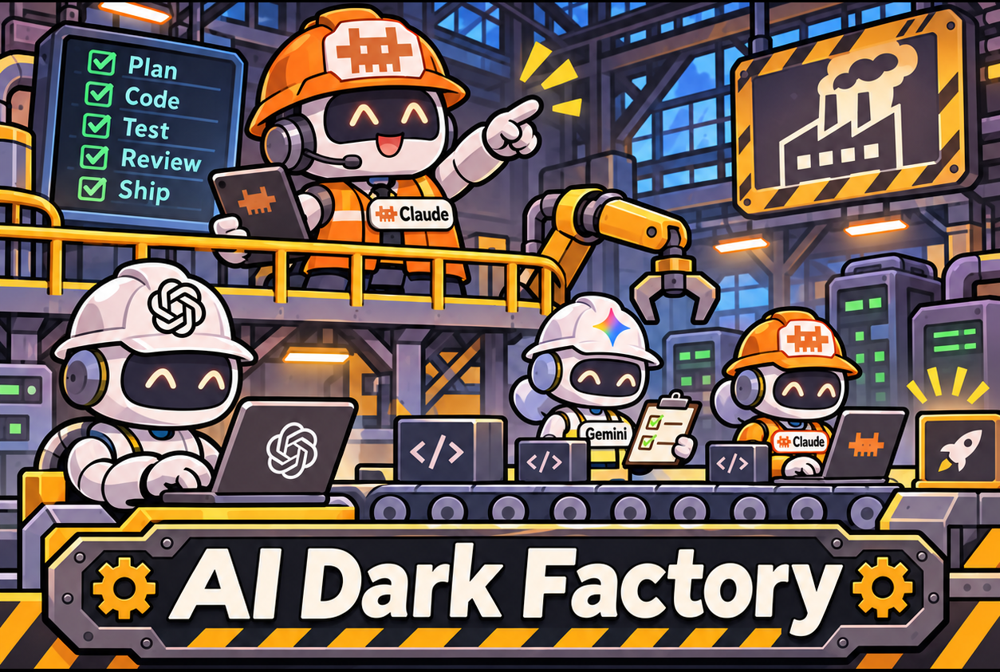

# AI Dark Factory

**Autonomous agent workflows that plan and implement on their own, checked by multi-agent review across models from different vendors.**

Dark Factory is a workflow engine for Claude Code and Codex. Agents write the code, and other
agents from different vendors check it: Claude Opus and Sonnet, Codex Astra, Gemini, or any
model OpenRouter serves. Every run works in its own git worktrees, reviewers start in fresh
contexts, the verification gate runs on a frozen snapshot, and code rather than a model decides
whether the result is ready. Nothing reaches your checkout until you deliver it.

## The Workflows

| Workflow | Use It For | What You Get Back | Rough Cost |
|---|---|---|---|
| [`factory`](docs/factory.md) | Any task, when you don't know how much review it needs. It picks the lightest process that fits and moves up if needed. | The finished result. | 6–50 turns, by tier. |
| [`pair`](docs/pair.md) | A scoped change that one agent should own. One author and one reviewer repeat until review passes. | A reviewed snapshot, or the open findings. | 12–17 turns. |
| [`council`](docs/council.md) | A subtle bug, a design with real trade-offs, or a problem with several plausible answers. Several seats solve it blind, then debate. | One converged result, or the scorecard's pick. | 30–50 turns. |
| [`ensemble`](docs/ensemble.md) | A task worth several attempts. Independent solvers each try it, and every attempt is reviewed. | Ranked candidates for you to pick or merge. | About 18 turns. |
| [`run-plan`](docs/run-plan.md) | A whole plan of tasks. Each goes through factory or pair and is committed once verified. | Local commits, parked questions, and a final acceptance check. | Per task. |

## Install

### Claude Code

In a session:

    /plugin marketplace add markrogoyski/ai-dark-factory
    /plugin install dark-factory@ai-dark-factory

Then add this permission to `~/.claude/settings.json` (a plugin can't grant it, and the relay
and vendor seats need it), and start a new session:

    "permissions": { "allow": [ "Bash(dark-factory:*)" ] }

The default lineups also use the [`codex`](https://github.com/openai/codex) and `agy`
(Antigravity) CLIs, each installed and logged in. Gemini seats also need
`"toolPermission": "proceed-in-sandbox"` in `~/.gemini/antigravity-cli/settings.json`. Without
those CLIs, pick Claude-only models (see the examples below).

### Codex

Clone the repository somewhere it can stay and link the skill into your project:

```sh
git clone https://github.com/markrogoyski/ai-dark-factory.git ~/ai-dark-factory
~/ai-dark-factory/install-codex.sh --repo /path/to/project
```

[Installing](docs/install.md) has the full requirements, why each setting is needed, and how to
update and uninstall.

## Examples

Run from a repository with a clean working tree.

### Small Change

You have a small change and don't want to decide how much review it needs. Factory sizes it;
this one goes to the Simple tier, one implementer and one reviewer:

    /dark-factory:factory Add a debug log line with the retry count in Fetcher::retry

### Scoped Feature

You have a scoped feature and want one agent to own it end to end. Pair drafts a design, gets
it reviewed, implements it, and fixes findings until the measured result passes review:

    /dark-factory:pair Implement the retry policy with jittered exponential backoff in HttpClient

### Tricky Bug

You have a bug where the obvious fix might be wrong. The council's seats investigate
independently, then debate until they agree:

    /dark-factory:council Fix the race condition that lets two workers claim the same job

### Several Approaches

You want to see several approaches before choosing. Ensemble returns ranked, cross-reviewed
candidates and leaves the choice to you:

    /dark-factory:ensemble Find why pagination skips the last item when the page size divides the total

### Whole Plan

You have a plan and want it built and committed task by task. Run-plan works the tasks in
dependency order and parks any that need your answer ([plan format](docs/run-plan.md)):

    /dark-factory:run-plan {planFile: "/absolute/path/plan.json", repo: "/path/to/project"}

### Claude Only

You only have Claude. Name the models:

    /dark-factory:pair --author opus --reviewer sonnet Implement the retry policy
    /dark-factory:council --seats opus,sonnet,fable Fix the race condition that lets two workers claim the same job

### Codex Only

You only have Codex. Name the seats:

    /dark-factory:council --seats astra,sol,luna Fix the race condition that lets two workers claim the same job

### In Codex

The same workflows go through one skill:

```text
$dark-factory Add a debug log line with the retry count in Fetcher::retry
$dark-factory --tier fix Find why the sync drops the last page
$dark-factory --workflow pair Implement the retry policy
```

## During a Run

In Claude Code, `/workflows` shows the running workflow's milestones as they happen. To follow it
from another terminal, run the helper's `watch` in the directory you started the workflow from. It
prints a line as each step starts and finishes, with a short summary of its result, and the run's
milestones when it ends:

    ~/.claude/plugins/cache/ai-dark-factory/dark-factory/*/bin/dark-factory watch

(From a clone installed with `./install.sh`, it's `plugins/dark-factory/bin/dark-factory watch`.)
In Codex, the runner already prints progress as it goes. See
[Following a run as it goes](docs/results.md#following-a-run-as-it-goes).

## After a Run

Each run returns a result with a `final.readiness`. A ready change stays in its worktree until
you deliver it with `dark-factory apply`, which stages the reviewed snapshot without committing,
and `dark-factory verify-delivery`, which checks the delivered bytes and reruns the gate in your
checkout. [Reading a result](docs/results.md) explains the statuses, and
[Verification and delivery](docs/verification-and-delivery.md) the commands.

## Documentation

Everything else is in [`docs/`](docs/README.md):

| | |
|---|---|
| **Workflows** | [Factory](docs/factory.md) · [Pair](docs/pair.md) · [Council](docs/council.md) · [Ensemble](docs/ensemble.md) · [Run-plan](docs/run-plan.md) |
| **Using them** | [Installing](docs/install.md) · [Reading a result](docs/results.md) · [Choosing the models](docs/models.md) · [Running in Codex](docs/codex.md) · [Process controls and resume](docs/process-controls.md) · [Verification and delivery](docs/verification-and-delivery.md) |
| **Measuring and tuning** | [Evaluating process value](docs/evaluation.md) · [Process retro](docs/process-retro.md) |
| **Internals** | [Architecture](docs/architecture.md) · [Pinning the engine](docs/engine-pinning.md) · [Development](docs/development.md) · [Gotchas and troubleshooting](docs/gotchas.md) |
